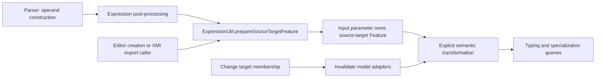

# Feature-chain source-target preparation

## Purpose

ST6RI-981 separates structural preparation of feature-chain expressions from
semantic consultation, following expression result preparation in ST6RI-979.
Derived queries and cache computation do not create the owned source-target
feature. Typing and redefinitions remain computed from the current expression
and its target. On this Pilot branch, semantic queries use adapter caches and
explicit transformation.
The Obeo variant additionally supports uncached implicit-specialization computation.

## Preparation and consultation

For a textual expression such as `v.n`, the parser constructs a
`FeatureChainExpression` with an input parameter whose value refers to `v`, a
membership referring to `n`, and an output result prepared by ST6RI-979.
`ExpressionParserPostProcessor` then calls
`ExpressionUtil.prepareSourceTargetFeature(FeatureChainExpression)`.

The helper inspects the expression's owned feature memberships in order and
selects the first feature with stored direction `IN`. It inspects that feature's
owned feature memberships, preserving existing nested features and their names.
If none exists, it creates one nested Feature and its FeatureMembership. The
nested feature has the empty declared name to suppress effective naming.

These operations inspect only local containment and stored direction. They do
not follow the source value, target membership, inferred types or specialization
targets. The owned-member accessor used by the helper reads the membership's
contained elements. Repeated preparation preserves element identities. An
expression without an input is left unchanged and can be prepared after the
input is installed. Preparation does not install or invalidate caches.

`FeatureChainExpressionAdapter` has no structural preparation override.
`sourceTargetFeature()` returns the first owned feature found beneath an owned
input feature. Other semantic queries use the prepared structure and do not
recreate a removed source target.

The specialization rules use the nested feature to redefine the expression's
`targetFeature` and `ControlFunctions::'.'::source::target`. The result specializes
the chain of the source parameter and the source-target feature. These rules are
implemented here by `FeatureChainExpressionAdapter.addTargetRedefinition` and
`addResultTyping`, invoked by explicit transformation. Those methods are retained
when removing the structural preparation override. `addTargetRedefinition` skips
an absent source target: incomplete models must not fail or be repaired by
transformation. The separate implicit-specialization service of ST6RI-969 is not
present on this branch.

Two different structures must not be confused: `a.next.next` may represent a
single expression whose target is a feature chain, whereas `(a.next).next`
explicitly nests two FeatureChainExpressions.

## Producer and editor responsibilities

Programmatic builders and XMI consumers must call the helper after constructing
or loading a chain lacking its nested source target, before semantic consultation.
Loading XMI alone does not invoke parser post-processors. No automatic preparation
is added to the generic XMI loader or generated EMF editing commands. A serialized
chain that already contains its source target needs no repair.

Changing the target membership preserves ownership and identity of the prepared
feature. The regression tests exercise a missing target followed by Boolean and
Integer targets without another preparation call. On Pilot, tests remove model
adapters with `ElementUtil.clean` and explicitly transform the resource with
materialization disabled to refresh the semantic results. This is not a claim
of automatic dependency invalidation or pre-transformation semantic computation.

Replacing the source input requires preparing the replacement explicitly. The
old nested feature remains owned by the old input. Removing the source target
also requires explicit preparation to restore it; queries do not repair incomplete
editor states. Callers remain responsible for their existing cache invalidation
policy when modifying cached models.

## Ordering and limitations

Preparation selects the first input even if an output parameter was inserted
before it. The earlier consultation-time creator selected the first parameter
regardless of direction and could incorrectly attach the nested feature to an
output in programmatically constructed models. This ordering difference is
intentional and covered by a regression test.

For an incomplete model with several inputs, preparation handles the first input
and leaves subsequent inputs unchanged, including their nested features. The
existing reader still searches across inputs: before explicit preparation, it
can return a nested feature of a later input if the first input has none. No
change to that query's semantics is included here.

Parser preparation introduces the nested feature before linking. Tests cover
unresolved references, repeated parser callbacks, nested chains and cyclic source
subsettings. They do not establish performance equivalence; benchmark execution
remains deferred at the user's request.

## Regression coverage

`FeatureChainConsultationTest` covers:

- Cached textual chain: source-target and result identity, target and library
  redefinitions, synthesized result chain, typing, argument order and repeated
  materialization.
- Target edits with adapter invalidation: missing target, replacement and restoration, with stable
  containment through explicit semantic transformation.
- Nested expressions with cyclic source subsettings and recursive structure typing.
- Incomplete programmatic construction followed by explicit preparation.
- Preservation of an explicitly supplied nested feature.
- XMI loading without a source-target feature, then explicit preparation.
- Parser preparation before reference resolution and idempotent callbacks.
- Removal of the nested feature followed by cold semantic queries that do not
  recreate it.
- Output-before-input construction, multiple inputs and replacement of the source.

Existing `ExpressionResultConsultationTest` complements these tests for result
preparation and the Pilot transformation lifecycle.

## Pilot branch adaptation

This branch is based on `pilot/ST6RI-979` (05c91f36c), matching
`origin/ST6RI-979` when the port was prepared. The two ST6RI-981 commits originate
from 5f8d782f6 and 3de02009c on the Obeo branch.

Pilot does not yet contain ST6RI-969's implicit-specialization service or
ST6RI-977's virtual containers. The test fixture therefore uses the existing
interactive loader directly. Semantic assertions use `ElementUtil.transformAll`
with materialization disabled; target edits reset model adapters with
`ElementUtil.clean` before transformation, as in Pilot's ST6RI-979 tests.
The original assertions about target identities, result types and cycles remain.
Service-specific cache policy assertions do not apply to this branch. The
stronger pre-transformation semantic coverage remains on the Obeo branch.

The existing `FeatureChainExpressionAdapter.addResultTyping`,
`addTargetRedefinition` and `doTransform` methods are preserved. Only the structural
creation override is removed;
a null guard also allows transformation of an incomplete, unprepared chain.

History comparison also found ST6RI-947, ST6RI-972, ST6RI-977 and ST6RI-969 on the
Obeo side, together with deployment and formatting changes. None is imported as
an additional prerequisite for this structural refactoring. Pilot already has
its own ST6RI-954 fix, newer ST6RI-974 changes and the explicit model/logic Eclipse
classpath references. These existing Pilot changes are retained.

Pilot baseline validation on 2026-10-13: root `mvn clean verify` succeeded in
5 min 28 s (1548 tests reported, no failures or errors, 22 skipped), including
the six feature-chain scenarios. Both bundled JARs were rebuilt. No benchmark ran.

Pilot implementation validation on 2026-10-13: root `mvn clean verify` succeeded
in 5 min 07 s (1551 tests reported, no failures or errors, 22 skipped), including
the nine feature-chain scenarios. Both bundled JARs were rebuilt. No benchmark ran.
