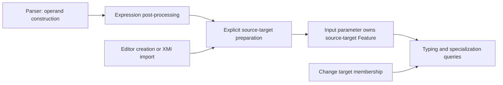

# Feature-chain source-target preparation

## Purpose and status

This note covers the lot 0 sublot following expression result preparation
(ST6RI-979). It separates observations about the current implementation from the
proposed next change. Only regression tests are added at this stage; production
behavior is unchanged.

The objective is to stop semantic consultation and cache computation from creating
an owned source-target feature. Typing, redefinitions, argument order and existing
model element identities must be preserved. Pilot caching and SysON's use of
uncached editable models must both remain supported.

## Current behavior

For a textual expression such as `v.n`, the parser creates a
`FeatureChainExpression` with an input parameter whose value refers to `v`, a
membership referring to `n`, and an output result prepared by ST6RI-979.

`FeatureChainExpressionAdapter.addAdditionalMembers()` selects the first owned
parameter using `TypeUtil.getOwnedParameterOf(expression, 0, Feature.class)`.
If that parameter has no owned feature, it creates a nested Feature and its
FeatureMembership. Its declared name is the empty string to suppress effective
naming. Existing nested features are retained, including their names.

`sourceTargetFeature()` does not itself prepare anything: its invocation delegate
returns the first owned feature found beneath an owned input feature. Preparation
can instead be triggered by result lookup, feature membership consultation,
linking or transformation through `addAdditionalMembers()`.

The specialization rules use that nested feature to redefine the expression's
`targetFeature` and `ControlFunctions::'.'::source::target`. The result specializes
the chain of the source parameter and the source-target feature. These rules are
implemented by `featureChainExpressionTargetRedefinition` and
`featureChainExpressionResultSpecialization` in `KerMLExpressionRules`; their
Javadoc cites KerML section 8.3.4.8.4 and section 8.4.4.1, Table 11, note 5.

Two different structures must not be confused: `a.next.next` may represent a
single expression whose target is a feature chain, whereas `(a.next).next`
explicitly nests two FeatureChainExpressions.

## Proposed preparation boundary — not implemented

Reuse the parser post-processing boundary introduced by ST6RI-979. Introduce one
small, explicit mutation helper for preparing a FeatureChainExpression's nested
source target, callable by parser post-processing and by programmatic/XMI
producers. A separate service or persistent dependency registry is unnecessary.

The helper should:

- Inspect stored containment and direction without resolving the source value,
  target membership, inferred types or specialization targets.
- Retain an existing nested feature and create at most one anonymous nested
  feature when the source input exists and has none.
- Tolerate an incomplete expression with no source input; its producer calls
  preparation again when it installs the input.
- Leave result typing and redefinitions to the semantic queries.

Parser-created operands already receive direction IN through
`TypeUtil.addOwnedParameterTo`, before expression post-processing. The preparation
must therefore run after operand construction; inserting the output result must
not influence source selection.

Once this preparation is validated, remove source-target creation from
`FeatureChainExpressionAdapter.addAdditionalMembers()`. Queries must not recreate
a deleted source target. Non-textual producers must invoke preparation explicitly;
loading XMI alone does not invoke the parser post-processors.

## Incremental editing and risks

Changing the target membership does not change ownership of the source-target
feature. Tests exercise a missing target followed by Boolean and Integer targets,
without transformation or a second explicit preparation. The structure remains
stable and semantic results follow the edits. Model specialization caching is
disabled by the existing test fixture; legacy derived caches are explicitly
cleared. This is not a claim of automatic dependency invalidation.

Replacing or removing the source input is a different lifecycle event: the nested
feature belongs to that input. A replacement input must be prepared explicitly.
This scenario needs additional acceptance tests in the implementation step.

Source selection needs review before implementation. The current creator selects
the first **parameter**, regardless of direction, whereas the reader selects
features below **inputs**. In a programmatic model with the output inserted before
the input, the creator can consequently attach the nested feature to the output.
The proposed helper should select the first input using local stored structure;
this changes that ordering behavior and must be covered
explicitly rather than silently copied. Multiple inputs with an empty first input
also require care: the current reader can return a nested feature of a later input.
No production correction of these cases is included in the baseline commit.

Earlier creation changes containment traversal order and may expose the nested
feature to linking sooner. Test unresolved targets, repeated post-processing and
nested consultations before accepting the parser move. Terminating a traversal
does not prove that its inferred results are complete; preserve the service's
recursion handling and avoid caching incomplete results as complete.

## Regression coverage and delivery boundary

`FeatureChainConsultationTest` adds six scenarios:

- Cached textual chain: source-target and result identity, target and library
  redefinitions, synthesized result chain, typing, argument order and repeated
  materialization.
- Uncached target edits: missing target, replacement and restoration, with stable
  containment and no semantic transformation.
- Nested expressions with cyclic source subsettings and recursive structure typing.
- Incomplete programmatic construction followed by source input construction.
- Preservation of an explicitly supplied nested feature.
- XMI loading without a source-target feature, followed by consultation.

Existing `VirtualContainerTest` and
`ContextualFeatureChainConnectorFlowLoopImplicitSpecializationTest` complement
these tests for detached result chains and implicit redefinitions.

The baseline deliberately permits current consultation-time creation. The next
commit must adapt the programmatic and XMI scenarios to explicit preparation and
add assertions that reads do not create or recreate the nested feature, including
with cold caches. Parser preparation must be idempotent and leave proxies
unresolved. Broader source-replacement and input-order coverage belongs in that
same implementation step.

Each code step requires a full root `mvn clean verify` and its rebuilt bundled
JARs. Benchmark execution is deferred at the user's request; performance
equivalence is not established by these tests. Review this baseline before
implementing the proposed preparation boundary.

Baseline validation on 2026-10-12: root `mvn clean verify` succeeded in 10 min
12 s (1669 tests reported, no failures or errors, 22 skipped). The six focused
feature-chain scenarios also passed independently. No benchmark was run.

## Pilot branch adaptation

This branch is based on `pilot/ST6RI-979` (05c91f36c), matching
`origin/ST6RI-979` when the port was prepared. The two ST6RI-981 commits originate
from 5f8d782f6 and 3de02009c on the Obeo branch.

Pilot does not yet contain ST6RI-969's implicit-specialization service or
ST6RI-977's virtual containers. The test fixture therefore uses the existing
interactive loader directly. Semantic assertions use `ElementUtil.transformAll`
with materialization disabled; target edits reset model adapters with
`ElementUtil.clean` before transformation, as in Pilot's ST6RI-979 tests.
The original assertions about target identities, result types and cycles remain.
Service-specific cache policy assertions do not apply to this branch. The
stronger pre-transformation semantic coverage remains on the Obeo branch.

The existing `FeatureChainExpressionAdapter.addResultTyping`,
`addTargetRedefinition` and `doTransform` methods must be preserved when moving
structural preparation. The references above to `KerMLExpressionRules` describe
the Obeo implementation; Pilot computes these relations in the adapter.

History comparison also found ST6RI-947, ST6RI-972, ST6RI-977 and ST6RI-969 on the
Obeo side, together with deployment and formatting changes. None is imported as
an additional prerequisite for this structural refactoring. Pilot already has
its own ST6RI-954 fix, newer ST6RI-974 changes and the explicit model/logic Eclipse
classpath references. These existing Pilot changes are retained.

The Obeo baseline validation figures above are historical; Pilot validation is
recorded separately after rebuilding this commit.

Pilot baseline validation on 2026-10-13: root `mvn clean verify` succeeded in
5 min 28 s (1548 tests reported, no failures or errors, 22 skipped), including
the six feature-chain scenarios. Both bundled JARs were rebuilt. No benchmark ran.
